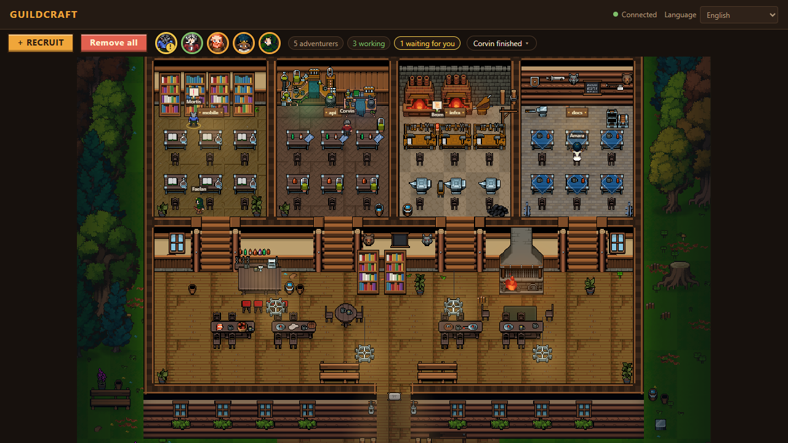
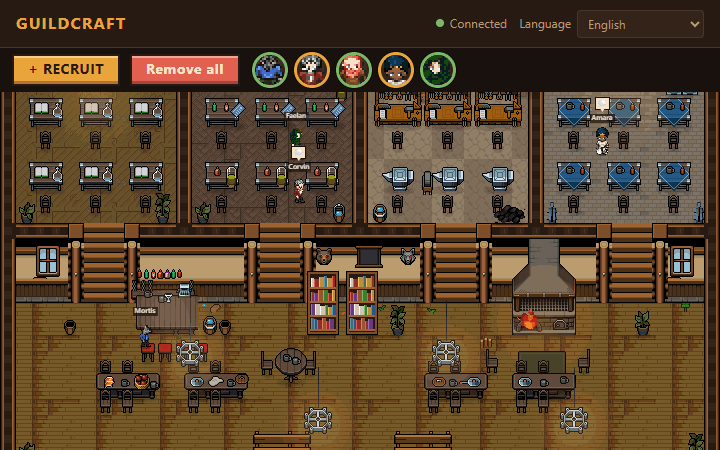
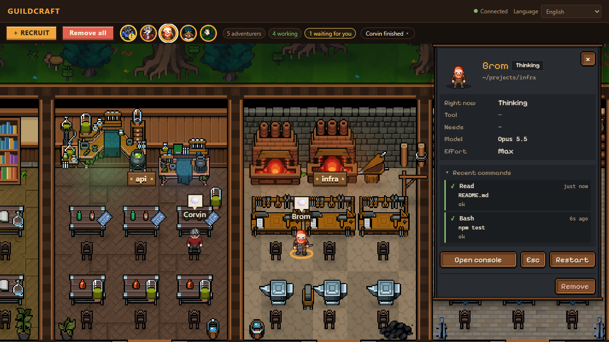
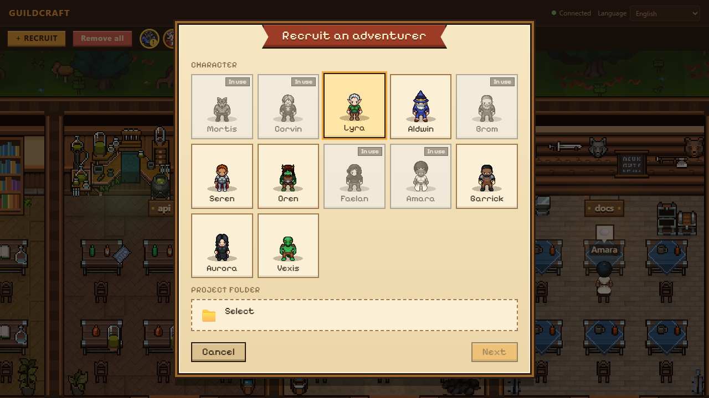

# Guildcraft

[English](README.md) | **Português (BR)** | [Русский](README.ru.md)

[](https://github.com/ogabrielalves/guildcraft/actions/workflows/ci.yml)
[](LICENSE)


Uma oficina de guilda em pixel art onde cada aventureiro é um agente Claude Code de verdade. 🏰

Você recruta um aventureiro por pasta de projeto, e cada um deles é um processo `claude` real rodando naquela pasta. Eles ficam nas suas estações, andam pela oficina e mudam de pose conforme o que o agente está fazendo de fato. Clica em um e abre o console dele. Pede para um falar com outro e vê a mensagem atravessar a sala.

> Em desenvolvimento. Ainda não foi publicado.





## O que ele faz

Rodar várias sessões do Claude Code em terminais separados vira bagunça rápido. Você perde a noção de qual está pensando, qual está travado esperando uma permissão e qual terminou há dez minutos. O Guildcraft junta todos num lugar só e transforma o estado de cada um em algo que dá para ler de relance.

- **Um aldeão por projeto.** Escolha uma pasta, dê um nome e um visual, e um agente Claude Code começa a rodar ali.
- **Status que você enxerga.** Trabalhando, parado, esperando permissão: a pose e a posição do aldeão dizem isso sem você abrir nada.
- **Console de verdade.** Clique no aldeão para abrir o terminal dele. É a TUI real do Claude Code, não um visualizador de log, e a tela é restaurada se você recarregar a página.
- **Permissões pela interface do jogo.** Quando um agente pede para executar algo, aparece um card e você responde ali mesmo.
- **Agentes conversando entre si.** Cada agente ganha um servidor MCP pequeno com `list_villagers` e `send_message`. Quando um manda mensagem, o aldeão dele caminha até o destinatário, e a mensagem só é entregue quando o destinatário estiver livre.
- **Histórico de atividade.** Modelo, esforço e a lista de ações recentes de cada agente, lidos dos arquivos de sessão do próprio Claude Code.

Tudo roda na sua máquina. Nada é enviado para fora além do que o próprio Claude Code já envia.

### Vendo de perto

| Painel do agente                                                                       | Recrutamento                                                                         |
| -------------------------------------------------------------------------------------- | ------------------------------------------------------------------------------------ |
|  |  |

## Como funciona

```
 navegador (canvas + xterm)
        |  WebSocket
        v
 servidor guildcraft (Node) --- inicia ---> claude (em um PTY, um por agente)
        ^                                        |
        | HTTP POST                              | hooks + MCP
        +------------ bin/hook.js, bin/mcp.js <--+
```

1. Você cria um agente na interface. O servidor escreve um `settings.json` e um `mcp.json` por agente, apontando os hooks e o MCP do Claude Code para os scripts auxiliares do guildcraft.
2. O servidor inicia o `claude` dentro de um PTY (node-pty) e espelha a tela com um xterm headless, assim o console pode ser restaurado depois.
3. O Claude Code dispara hooks (uso de ferramenta, parada, notificação e por aí vai). O script de hook faz POST de volta no servidor, que converte isso em status e transmite por WebSocket.
4. O navegador recebe o status e o aldeão muda de pose. A leitura do transcript completa o que os hooks não entregam: modelo, esforço e histórico de ações.
5. Nas mensagens entre agentes, a chamada MCP `send_message` chega no servidor, que transmite uma visita (o aldeão caminha até lá) e guarda o texto numa fila até o destinatário ficar livre, quando então cola no PTY dele.

O front end é um motor Canvas 2D puro, sem framework. Personagens, estações e o mapa são dados em `assets/`, então mudar a arte ou o layout não mexe no código. Veja [docs/ASSETS.md](docs/ASSETS.md).

### Como os agentes se encontram

Os agentes conversam entre si pelo **nome**, não pelo id. O próprio Claude Code não sabe nada sobre o registro do guildcraft. Tudo o que está abaixo acontece no servidor.

1. Cada agente tem um nome único (o servidor recusa duplicados) e um UUID interno. O servidor mantém um registro que liga o nome, o UUID e o PTY onde roda o `claude` daquele agente.
2. Um agente chama a ferramenta MCP `list_villagers` para ver quem mais está por perto (nome, pasta, status, o que está fazendo) e depois `send_message` com `to: "<nome>"`.
3. O auxiliar MCP envia `POST /api/<id-do-remetente>/messages`. O id do remetente vem do `mcp.json` do próprio agente, e é assim que o servidor sabe quem está falando.
4. O servidor procura o destinatário pelo nome (sem diferenciar maiúsculas de minúsculas e ignorando espaços nas pontas), acha o PTY dele pelo UUID e guarda o texto numa fila até o destinatário ficar livre. Então digita o texto nesse console como `[Message from <remetente>]`.
5. Nome desconhecido, destinatário offline ou fila cheia voltam para o remetente como uma mensagem de erro simples.

O nome não é injetado no prompt do modelo: o agente descobre os outros por `list_villagers` e quem escreveu pra ele pelo prefixo `[Message from ...]`.

## Segurança

- O servidor escuta apenas em `127.0.0.1`.
- Cada sessão recebe um token aleatório, e o WebSocket confere o token e o cabeçalho `Origin`.
- Os agentes sobem com as variáveis `GUILDCRAFT_*` e as da sessão pai do Claude Code removidas do ambiente.

## Requisitos

- Node.js 20+
- Claude Code instalado e com login feito

## Plataformas suportadas

| Plataforma | Status               |
| ---------- | -------------------- |
| Windows 11 | ✅ Testado, funciona |
| Linux      | ⏳ Teste pendente    |
| macOS      | ⏳ Teste pendente    |

O CI compila e roda a suíte de testes nos três, mas o app em si só foi usado manualmente no Windows 11 até agora.

## Como usar

```sh
npx guildcraft
```

Ele abre a oficina no navegador. A porta padrão é a 7777, e dá para trocar com `GUILDCRAFT_PORT`.

Quer só dar uma olhada, sem servidor nem Claude? Abra o app web com `?demo` e você terá agentes simulados.

## Perguntas frequentes

**Usar `/model` ou `/effort` dentro de um agente muda só aquele agente?**
Não. O Claude Code salva os dois como padrão global, então a mudança vale também para os próximos agentes que você recrutar e para as suas sessões normais do Claude Code.

**Dá para colar imagem no console de um agente com Ctrl+V?**
Ainda não. Texto cola normalmente, mas colar imagem não funciona no console.

## Desenvolvimento

```sh
npm install
npm run dev
```

| Script                  | O que faz                                         |
| ----------------------- | ------------------------------------------------- |
| `npm run dev`           | Servidor e web com live reload                    |
| `npm run build`         | Gera o build em `dist/`                           |
| `npm run lint`          | ESLint                                            |
| `npm run typecheck`     | TypeScript do servidor e do web                   |
| `npm test`              | Testes unitários e de integração                  |
| `npm run test:coverage` | Os mesmos testes com o mínimo de 80% de cobertura |

Contribuições são bem-vindas. Veja o [CONTRIBUTING.md](CONTRIBUTING.md).

## Licença

O Guildcraft é source-available (código disponível) e gratuito para todo mundo usar, estudar, modificar e compartilhar, desde que não seja para fins comerciais. Não é permitido vendê-lo nem usá-lo comercialmente. O código está sob a [PolyForm Noncommercial License 1.0.0](LICENSE). Os assets de arte mantêm as próprias licenças, listadas em `assets/CREDITS.md`.
